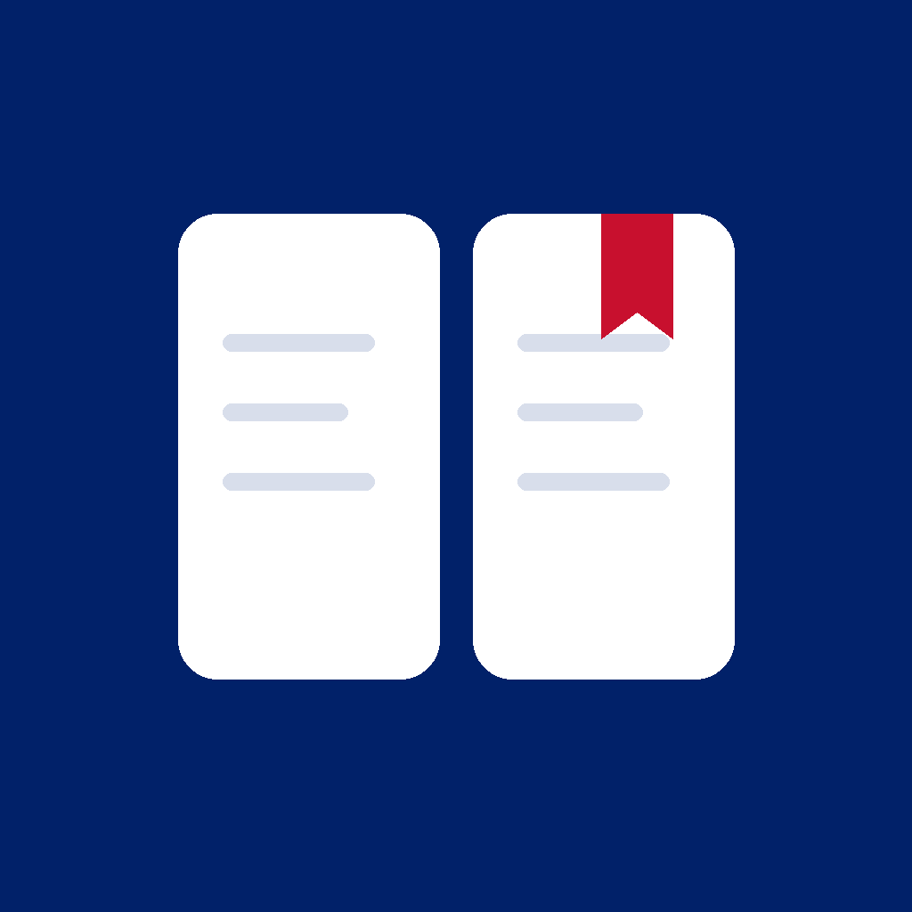

<p align="center">
  
</p>

<h1 align="center">Englishgram</h1>

<p align="center">Offline English grammar and vocabulary practice for iPhone.</p>

<p align="center">
  
  
  
  
  
</p>

## Demo

**Video:** `https://youtu.be/wd2aoqUtGsM`

The suggested video title and description are in [YOUTUBE_DESCRIPTION.md](YOUTUBE_DESCRIPTION.md).

## Overview

Englishgram is a personal iOS project for learners who want a structured way to study English grammar and build a small everyday vocabulary without an account or internet connection.

The grammar path moves through bundled A1, A2 and B1 topics. Each topic combines explanations, examples, practice and a final test. Russian, Polish and Ukrainian interfaces and course explanations accompany English examples. Vocabulary study is available independently of grammar progression.

## Key Features

- **A sequential grammar path:** 20 topics covering essentials such as verb tenses, articles, modals, conditionals, passive voice and relative clauses. Passing a topic's final test unlocks the next topic.
- **Five stages per topic:** a lecture, 10 foundation exercises, 10 translation exercises, 12 varied practice questions and 17 final-test questions—980 grammar questions in total. Final completion requires at least 70%; completed stages and the best final score remain available after retakes.
- **Interactive exercises:** answer selection and word-chip sentence construction, including negatives, questions, corrections, person changes, short answers and clause combining. Lectures include expandable self-check answers.
- **Resumable quizzes:** pause and return to a saved grammar, review or vocabulary quiz. The question position, answer selection, shuffled choices, word order and checked answers survive relaunch.
- **Adaptive grammar review:** choose completed topics, 5–20 questions, difficulty and exercise type. Selection favors weaker topics and recent mistakes, avoids duplicate prompt/answer pairs, and fills shortages with other exercise types from the same topics.
- **Vocabulary study:** 30 bundled words with translations and English examples, flashcards that repeat missed words, multiple-choice translation quizzes in both directions, and a searchable learned-word dictionary.
- **Progress from completed activity:** XP, accuracy, activity streaks, topic rankings, best final scores, recent sessions and mistake explanations. Vocabulary quizzes contribute to overall answer statistics; learned words and word quizzes also have separate counts.
- **Personal preferences:** immediate language switching, light/dark/device appearance, sound and haptic controls, optional answer explanations and a default review difficulty. Reset clears learning progress while retaining settings.

## Screenshots

<!-- No app screenshots are committed. Add real captures using relative repository paths:
Learn (course path), a lecture, a word-chip exercise, Review setup, Study flashcards,
and Progress. Include a dark appearance or Polish/Ukrainian example where useful.
Do not use the app icon or generated mockups as substitutes for screen captures. -->

## Tech Stack

| Technology | Purpose in this project |
| --- | --- |
| Swift | Value-type course, session and progress models; learning rules, scoring and statistics. The project uses Swift 5 language mode. |
| SwiftUI | All application screens, native navigation, forms, sheets, full-screen quizzes, animations and sensory feedback. A shared component layer supplies cards, buttons, colors and a wrapping layout for word chips. |
| Combine / ObservableObject | `@Published` state in the app-wide `ViewModelEG` and the vocabulary presentation model. Views own models with `@StateObject` or observe injected models with `@ObservedObject`. |
| SwiftData | On-device persistence through `ProgressServiceEG`: one progress snapshot and separate completed-session records. |
| Foundation / Codable / JSON | Decode bundled courses and translations, encode persisted payloads, normalize answers and calculate calendar-based activity streaks. |
| String Catalogs | `Localizable.xcstrings` provides interface translations; a separate bundled JSON dictionary translates course text without an external service. |
| AVFoundation | Generate short success/error tones locally and play them with `AVAudioPlayer`; an actor isolates audio playback work. |
| XCTest | Existing tests cover course integrity, progression, persistence, review generation, vocabulary, localization and screen rendering. |
| Python 3 standard library | Development scripts author and regenerate course JSON and validate localization. Python is not part of the app runtime. |

There are no third-party package dependencies, CocoaPods dependencies, network layer or backend configuration. Course loading reads bundled files rather than remote endpoints.

## Architecture

The implementation follows MVVM with an app-wide state coordinator and a separate vocabulary presentation model. It is one application target, with an accompanying XCTest target.

- **Views** render observable state and forward user actions. `EnglishgramApp` owns `ViewModelEG`; child screens observe that instance. `StudyViewModelEG` owns transient flashcard and dictionary-search state.
- **ViewModels** coordinate progression, quiz actions, rewards, settings and persistence. The shared `ViewModelEG` also owns tab selection, the topic navigation path and quiz presentation.
- **Models** represent courses, questions, session drafts, completed records, preferences and vocabulary progress. `TestSessionEG` handles answer construction and checking; `StatisticsEG` derives metrics from saved activity.
- **Services** load and validate courses, persist progress, select review questions, resolve localization and generate audio feedback.

At launch, the coordinator loads stored progress, applies the selected language and decodes the local course. A view action updates the model, publishes state back to SwiftUI and explicitly saves through `ProgressServiceEG`. Session completion adds history, updates topic progress and removes the draft before saving them together.

SwiftData stores Codable JSON payloads in `ProgressStoreEG` and `SessionStoreEG`. Completed history is kept outside the progress snapshot, so routine draft saves do not re-encode the entire history. Existing history embedded in older snapshots is merged on load. In-memory and explicit store-URL configurations support previews and tests; sample progress is populated only for previews.

Navigation uses a `NavigationStack` with a typed topic path, navigation links for supporting screens and a full-screen quiz flow. The four primary sections—Learn, Review, Study and Progress—share a custom floating tab bar.

## Project Structure

```text
Englishgram/
├── App/             App entry point, launch coordination and primary navigation
├── Views/           Learning, quizzes, review, vocabulary, progress and settings
├── ViewModels/      Shared app state and vocabulary presentation state
├── Models/          Course types, sessions, progress, preferences and vocabulary
├── Services/        Content loading, storage, review selection, localization and sound
├── Components/      Reusable SwiftUI components, layout and design tokens
├── Data/            Bundled A1, A2 and B1 course JSON
├── Resources/       Interface string catalog and offline course translations
└── Assets.xcassets/ App icon and adaptive colors
Scripts/             Course authoring and localization maintenance tools
Tests/               XCTest logic, persistence and rendering checks
Englishgram.xcodeproj/ Application/test configuration and shared scheme
```

## Getting Started

### Requirements

- macOS with Xcode and an iOS SDK compatible with the project's build settings. The locally inspected toolchain is Xcode 27.1; the minimum compatible Xcode version has not been established.
- An existing iPhone simulator running iOS 17 or later, or a physical iPhone on iOS 17 or later.
- Python 3 only if editing course content or running localization validation.

The app target is configured for iPhone and portrait orientation, with an iOS 17.0 deployment target. No dependency installation, API keys, account setup or external services are required.

### Run

1. Open `Englishgram.xcodeproj` in Xcode.
2. Select the **Englishgram** shared scheme.
3. Select an installed compatible iPhone simulator, then choose **Product → Run**.
4. For a physical iPhone, select your own signing team under **Signing & Capabilities** and adjust the bundle identifier if needed.

### Existing tests

Choose **Product → Test**, or inspect installed destinations and use an existing compatible simulator UUID:

```sh
xcrun simctl list runtimes
xcrun simctl list devices available
xcodebuild -project Englishgram.xcodeproj -scheme Englishgram \
  -destination 'platform=iOS Simulator,id=<existing-compatible-simulator-UUID>' \
  CODE_SIGNING_ALLOWED=NO test
```

The test suite includes checks for all 980 answer keys, stage gates, final-test retakes, disk-backed persistence, draft restoration, review filters and duplicate prevention, vocabulary rewards, both quiz directions, legacy payload decoding, localization, preferences and streak dates. Its rendering harness hosts SwiftUI with UIKit and checks for rendered content at several sizes; UIKit is confined to the test target.

**Documentation review validation:** the localization validator was run successfully for Polish and Ukrainian, with 206 UI strings and 1,629 course strings per language. The iOS build and XCTest suite were not run as part of this documentation update.

### Content editing

The base lessons and sentence banks live in `Scripts/course_a1.py`, `course_a2.py` and `course_b1.py`. `lesson_expansions.py` supplies extended explanations and self-checks; `sentence_exercises.py` supplies additional sentence transformations.

```sh
python3 Scripts/build_course.py
python3 Scripts/validate_localization.py
```

The first command regenerates the three bundled course files and checks question counts, unique IDs, answer options and separation of training/final prompts. Preserve existing question IDs when extending content so saved attempts remain compatible. New course text also needs entries in `Englishgram/Resources/CourseTranslationsEG.json`; regeneration does not create translations.

`Scripts/update_strings.py` refreshes interface keys from compiler extraction output in a supplied Derived Data directory. It is a maintenance tool rather than a required setup step. Review catalog changes and complete translations afterward.

## Technical Highlights

1. **One persisted quiz engine.** Grammar training, final tests, adaptive reviews and vocabulary quizzes reuse the same draft and result models. Index-based word-chip identity keeps repeated words independently selectable, and answer checking guards against duplicate submissions.
2. **Weighted review without duplicate content.** Review selection deduplicates normalized prompt/answer pairs, weights topic accuracy and the last 50 incorrect answers, then incorporates the requested difficulty and type.
3. **Explicit local persistence.** Autosave is disabled in the storage service. User actions and scene transitions trigger saves, with visible save errors and a retry action; startup failures prevent overwriting progress.
4. **Offline localization across learning state.** Language changes update the course, active draft and in-memory history while retaining IDs and answers. Interface strings and course translations use separate bundled resources; English examples remain part of the learning content.
5. **Rewards with repeat protection.** Learning a word awards 10 XP once, successful flashcard recall awards 2 XP at most once per word per calendar day, and stage bonuses are awarded on first completion. SwiftUI accessibility labels, scalable typography and Reduce Motion checks accompany the custom interface.

## Limitations

- Progress is local to the device; there is no account, cloud synchronization or in-app export. Only one unfinished quiz is retained at a time. Flashcard deck position is transient rather than part of the saved quiz draft.
- The bundled curriculum and 30-word vocabulary are finite. A1/A2/B1 labels organize the course; they are not a proficiency assessment or certification.
- The interface supports Russian, Polish and Ukrainian; it does not provide an English interface. System-language selection falls back to Russian when no supported language is found.
- The existing project documentation records machine-generated Polish and Ukrainian course translations. Native-speaker editorial review is recommended before distribution; format and coverage validation cannot establish translation quality.
- Physical-device audio/haptics, VoiceOver traversal and interactive navigation on small iPhones still need manual verification before distribution.
